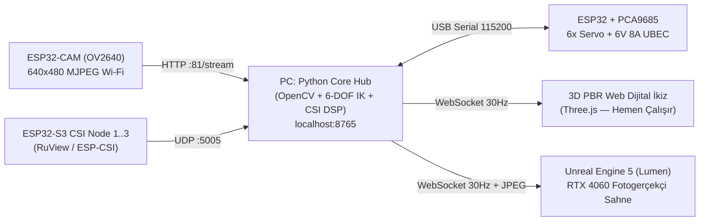

# Görüntü İşlemeli 6-DOF Robot Kol, Dijital İkiz ve Wi-Fi CSI Projesi
## Elektrik-Elektronik Mühendisliği Tasarım, Malzeme Listesi (BOM) ve Devre Rehberi

---

## 1. Sistem Mimarisi Özeti

Bu proje 4 alt sistemin tek bir gerçek zamanlı **Dijital İkiz (Digital Twin)** çekirdeğinde birleşmesinden oluşur:

---

## 2. Malzeme Listesi (BOM — Bill of Materials)

### A. Robot Kol Kontrol & Aktüatörler
| Bileşen | Adet | Önerilen Model / Özellik | Neden Bu Parça? |
| :--- | :---: | :--- | :--- |
| **Ana Kontrolcü** | 1 | ESP32 DevKit V1 (30/38 pin) | Çift çekirdek, Wi-Fi/BLE, kolay USB-Serial |
| **PWM Servo Sürücü** | 1 | PCA9685 16-Kanal I2C Modül | 12-bit donanımsal PWM, titreşimsiz 6 servo sürüşü |
| **Ana Eklemler (J1, J2, J3)** | 3 | **DS3218** (20 kg·cm, metal dişli, 6V) *(Ekonomik: MG996R 10 kg·cm)* | 35 cm uzanan PLA kolun omuz torkunu sarsıntısız taşır |
| **Bilek & Kıskaç (J4, J5, J6)** | 3 | **MG90S** (metal dişli mikro) veya **MG996R** | Bilek ucunda ağırlığı azaltarak omuz yükünü düşürür |
| **Harici Güç Kaynağı** | 1 | **6V 8A Adaptör** *(veya 12V 5A Adaptör + 6V 8A UBEC / Buck)* | 6 servo tepe akımında ESP32'nin reset atmasını önler |
| **Filtre Kondansatörü** | 1 | **1000 µF 16V** Elektrolitik Kondansatör | PCA9685 V+ hattına paralel bağlanır, ani akım çökmesini emer |
| **Acil Durdurma (E-Stop)** | 1 | Normalde Açık (NO) Mantar/Basma Buton | GPIO 4'ü GND'ye çekerek tüm servoları anında kilitler |
| **Voltaj Ölçüm (Opsiyonel)** | 2 | 10 kΩ (%1) Direnç | 2:1 gerilim bölücü ile GPIO 34 üzerinden 6V bara telemetrisi |

### B. Görüntü İşleme (Kamera & Aydınlatma)
| Bileşen | Adet | Önerilen Model / Özellik | Neden Bu Parça? |
| :--- | :---: | :--- | :--- |
| **Kamera Modülü** | 1 | **AI-Thinker ESP32-CAM + ESP32-CAM-MB** (USB adaptörlü set) | MB alt kartı FTDI kablo karmaşasını sıfırlar |
| **Kamera Gantrisi** | 1 | 2020 Alüminyum Profil (veya 3D baskı köprü, ~52 cm yükseklik) | Masaya dik ve sabit kalibrasyon açısı sağlar |
| **Çalışma Yüzeyi** | 1 | Koyu gri/siyah mat ESD altlık (veya mat karton) | Renkli küplerin HSV segmentasyon kontrastını artırır |
| **Test Küpleri** | 4 | 38×38×38 mm 3D baskı küpler (Kırmızı, Mavi, Yeşil, Sarı PLA) | OpenCV renk/boyut/konum/ağırlık analizi için |

### C. Wi-Fi CSI Ortam & Operatör Takibi (`ruvnet/RuView` & `espressif/esp-csi` Uyumlu)
| Bileşen | Adet | Önerilen Model / Özellik | Neden Bu Parça? |
| :--- | :---: | :--- | :--- |
| **Wi-Fi CSI Düğümleri** | 3 *(Başlangıç: 1)* | **ESP32-S3-DevKitC-1** (8 MB Flash, 8 MB PSRAM) | `ruvnet/RuView` resmi olarak ESP32-S3 gerektirir; 3 düğüm oda içi üçgenleme sağlar |
| **2.4 GHz Aydınlatıcı** | 1 | Mevcut ev/lab Wi-Fi Router (2.4 GHz) | CSI alt taşıyıcılarını üreten verici (TX) |

### D. Mekanik & 3D Baskı
- **Filament:** 1 kg **PLA+** veya **PETG** (0.2 mm katman yüksekliği, 4 duvar, %30 gyroid doluluk).
- **Bağlantı Elemanları:** M3 vida/somun seti (10 mm – 30 mm) + 2× **608ZZ** taban rulmanı + 25T alüminyum servo başlıkları (*metal servo horn* — plastik başlıklar DS3218 torkunda sıyrılabilir!).
- **Önerilen Açık Kaynak 3D Baskı Kol Tasarımları:**
  1. *HowToMechatronics 6-DOF Arduino/ESP32 Robot Arm* (MG996R + MG90S için en yaygın, bol dokümanlı tasarım)
  2. *EEZYbotARM MK2 / MK3* (paralel bağlantılı, omuz yükünü azaltan çok stabil tasarım)
  3. *Bittle/Thor benzeri 6-DOF MG996R Arm* (Printables / Thingiverse'de doğrudan STL mevcut)

---

## 3. Elektrik & Tork Mühendisliği Hesapları (Ders Raporu İçin)

### A. Omuz (J2) Maksimum Statik Tork Hesabı
Kol tam yatay uzandığında ($L_1 + L_2 \approx 0.34\text{ m}$), 3D baskı kol + bilek servoları (~$0.28\text{ kg}$ kütle merkezi $0.16\text{ m}$'de) ve uçtaki küp + kıskaç (~$0.14\text{ kg}$ kütle merkezi $0.34\text{ m}$'de) için:

$$\tau_{\text{omuz}} = (0.28 \times 9.81 \times 0.16) + (0.14 \times 9.81 \times 0.34) \approx 0.44 + 0.47 = 0.91\text{ N}\cdot\text{m} \approx 9.3\text{ kg}\cdot\text{cm}$$

2× güvenlik katsayısı ile **$18.6\text{ kg}\cdot\text{cm}$** önerilir → **DS3218 (20 kg·cm @ 6V)** omuz ve dirsek için tam isabet seçimdir.

### B. Güç Bütçesi (6.0V Servo Barası)
- Boşta bekleme (6 servo): ~`0.25 A` (`1.5 W`)
- Normal hareket (2–3 eksen aktif): `1.5 A – 2.8 A` (`9 – 17 W`)
- Anlık kalkış / maksimum yük tepe akımı: `4.5 A – 6.0 A` (`27 – 36 W`)
- **Sonuç:** ESP32'nin 5V/VIN pininden kesinlikle besleme yapılmaz. **6V 8A harici kaynak** PCA9685'in yeşil klemens (`V+` / `GND`) girişine bağlanır, ESP32 kendi USB'sinden beslenir ve iki tarafın **sadece GND hatları birleştirilir**.

---

## 4. Elektrik Bağlantı Şeması (Pinout)

| ESP32 Pini | Bağlandığı Bileşen | Görevi |
| :--- | :--- | :--- |
| `GPIO 21 (SDA)` | PCA9685 `SDA` | I2C Veri Hattı |
| `GPIO 22 (SCL)` | PCA9685 `SCL` | I2C Saat Hattı |
| `3.3V` | PCA9685 `VCC` | Lojik Besleme (3.3V güvenli!) |
| `GND` | PCA9685 `GND` + 6V Güç Kaynağı `GND` | **Ortak Toprak (Common GND)** |
| `GPIO 4` | E-Stop Butonu (diğer ucu `GND`) | Acil Durdurma (`INPUT_PULLUP`) |
| `GPIO 34` | 10kΩ + 10kΩ Gerilim Bölücü Orta Ucu | 6V Bara Gerilimi ADC Okuma |

**PCA9685 Kanal Atamaları:**
- `CH 0` → J1 Taban (Yaw)
- `CH 1` → J2 Omuz (Pitch)
- `CH 2` → J3 Dirsek (Pitch)
- `CH 3` → J4 Bilek Eğim (Pitch)
- `CH 4` → J5 Bilek Dönüş (Roll)
- `CH 5` → J6 Kıskaç (Gripper)

---

## 5. Wi-Fi CSI (`ruvnet/RuView`) Entegrasyon Notları
1. **Hemen Test (Donanımsız):** Arayüzde `Wi-Fi CSI` sekmesi varsayılan olarak **Simüle CSI** modundadır. 2D oda haritasına tıklayarak/sürükleyerek kendini (operatörü) odada gezdirebilir, 52 alt taşıyıcılı OFDM spektrumunu ve 3D Fresnel dalga kırılımını canlı izleyebilirsin.
2. **Gerçek ESP32-S3 ile Çalıştırma:**
   - Seçenek 1 (En Hızlı): `firmware/esp32_s3_csi_node/esp32_s3_csi_node.ino` kodunu 1–3 adet ESP32-S3'e yükle (`PC_IP` değerini kendi bilgisayarının IP'si yap).
   - Seçenek 2 (Tam RuView Ekosistemi): `https://github.com/ruvnet/RuView` reposundaki ESP32-S3 firmware'ini flashla; UDP port `5005` paketi bu projenin `wifi_csi_bridge.py` modülüyle doğrudan uyumludur.
3. Arayüzden **"Canlı ESP32-S3 (UDP:5005)"** düğmesine bastığın anda dijital ikiz gerçek RF verisine geçer.
